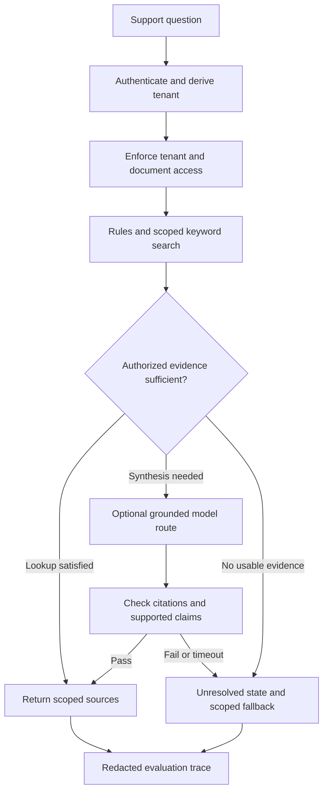

# Tenant-scoped document assistant: architecture and operating-cost evidence

Version: 1.0. Phase: approved evaluation continuation. Deliverable: evidence report only.

✅ Intake and phase approval are supplied as complete. The assistant supports users with documents, uses only supplied toy records, performs no actions in external systems, and incurs no additional spending. The product owner retains deployment authority. This report specifies designs and experiments; no integration, model call, search request, benchmark, or deployment was executed.

## Evidence and limits

| Evidence | Status | Permitted inference |
|---|---|---|
| Existing keyword search is available | Supplied fact | Include search as a baseline and a potential future component. Its tenant controls, capacity, and incremental resource cost remain unverified. |
| Model A: USD 2 total, 2 verified successes, 4 tasks | Supplied toy ledger | Calculate observed all-in cost per task and per verified success. |
| Model B: USD 1.20 total, 3 verified successes, 4 tasks | Supplied toy ledger | Calculate the same descriptive measures. |
| A latencies: 100, 200, 300, 1000 ms | Supplied toy measurements | Calculate empirical summaries of these four observations. |
| B latencies: 150, 250, 350, 450 ms | Supplied toy measurements | Calculate empirical summaries of these four observations. |
| Published API price, token counts, request breakdown | Not supplied | No API price, token budget, or production API cost can be established. |
| Document corpus, task text, tenant labels, ACLs, expected answers, individual retry/review records | Not supplied | Retrieval, isolation, grounded correctness, matched task comparisons, and cost attribution cannot be evaluated. |

🟡 The latency sample is treated as four observations per model. Whether each observation includes the full task, retries, review, retrieval, or only inference is unknown. Task alignment across A and B is also unknown. The supplied “verified success” label is accepted for arithmetic; its rubric and verification process have not been independently inspected.

## User intent and the AI hypothesis

🟡 Proposed intent: an authorized user asks a document question and receives either authorized search results, an answer supported by visible citations, or a clear unresolved state. The architecture assumes a read-only assistant. No sending messages, changing records, executing document instructions, or autonomous tools are included.

🟡 The measurable AI hypothesis is that synthesis across authorized documents improves verified task completion enough to justify its added cost and latency compared with existing search. AI need is unproven. Exact lookup and navigation can be tested with rules and keyword search; cross-document synthesis can be tested separately with RAG. A polished generated answer alone is not a success criterion.

## Architectural alternatives

| Alternative | Candidate behavior | Incremental-cost position | Evidence needed and limitations |
|---|---|---|---|
| Rules plus existing keyword search | Deterministic intent handling, tenant-scoped lookup, source snippets and links; no generated answer | No new provider charges are designed in. Existing compute, capacity and actual entitlements are unverified. | Establish search quality, isolation, and resource use. May be sufficient for lookup tasks. |
| Mock assistant | Scripted responses and simulated recovery using explicitly supplied toy fixtures | No external service calls; uses only an existing authorized environment | Validates interaction and state design, not model accuracy, retrieval quality, or real cost. No answer fixtures have been supplied. |
| Existing local model | Generate from tenant-authorized retrieved excerpts in an already available runtime | Zero additional spending only if model, hardware, rights, and capacity already exist and are authorized | Availability is unknown. No model download, package installation, provisioning, or execution is authorized. |
| API model with RAG | Search authorized documents, then send the minimum approved context for synthesis | Provider price and entitlement unknown; cannot establish zero incremental cost | External model calls are outside this phase. Requires separate data-handling authorization and verified pricing/entitlement. |
| Model routing with fallback | Resolve eligible requests using rules/search, route unresolved synthesis to a model, and fall back when evidence or resources are inadequate | Routing overhead and escalation can increase total cost; free operation is not established | Must evaluate the complete policy, including retries, review, fallback and unresolved tasks, rather than inference cost alone. |

✅ These are comparison candidates, not deployment selections. The currently executable scope remains report writing only. The historical toy ledger amounts are observations, not permission to spend USD 3.20 or repeat those runs.

## Candidate logical architecture

🟡 This is a specification, not an implemented or verified system. The optional model branch remains disabled unless a later phase explicitly authorizes it and verifies the cost and data boundaries. A minimal retrieval design can reuse keyword search. Embeddings or a vector database are optional alternatives requiring their own quality and cost evidence.

### Data, security and tool boundaries

| Boundary | Proposed control | Evidence required before implementation acceptance |
|---|---|---|
| Identity to tenant | Derive tenant identity from a trusted authenticated session; do not trust tenant IDs in prompts or client filters | Tenant membership and document authorization fixtures, including negative cases |
| Corpus and index | Every document and chunk carries tenant ID, document ID, version and access scope; enforce scope before retrieval and recheck before answering | Cross-tenant distractors, revoked access and stale index cases |
| Retrieved context | Keep only currently authorized excerpts; treat their contents as untrusted data, including embedded instructions | Injection fixtures must not alter tenant scope, authorization, routing or system behavior |
| Answer and citations | Reference document version and excerpt locator; verify each citation is accessible and supports the associated material claim | A citation existing is insufficient; support and authorization need separate checks |
| Conversation and cache | Partition history, caches, embeddings, keys and evaluation records by tenant and relevant access scope; invalidate on access/version changes | Same query across tenants, conversation switching and revocation tests |
| Model provider | No connection in this phase; any future approved use minimizes context and documents retention and region requirements | Explicit authorization, provider terms/configuration and verified cost entitlement |
| Tool execution | Read-only retrieval interface only; no shell, write, message, purchasing, or deployment tool available to the assistant | Tool allowlist and negative action tests |
| Observability | Tenant-scoped trace ID, route, evidence IDs/versions, outcome, latency, retries, review effort and cost provenance; avoid unnecessary document text | Trace completeness and access tests without exposing credentials or other tenants' content |

🟡 Failure recovery preserves authorization. A forbidden or missing source does not trigger a broader search. Permission errors fail closed. If the search system cannot enforce scope, the candidate cannot safely serve tenant documents. A timeout or unsupported answer returns authorized source results where available, otherwise an unresolved state. Human review is a proposed, separately authorized route, not an external message or a completed action.

## Transparent cost calculations

✅ All supplied costs already include retries and human review. These totals are used once; adding estimated retry or review charges again would double count them.

| Measure | Model A | Model B |
|---|---|---|
| Total observed cost | USD 2.00 | USD 1.20 |
| Submitted tasks | 4 | 4 |
| Verified successes | 2 | 3 |
| Observed success rate | 2 / 4 = 50% | 3 / 4 = 75% |
| Cost per submitted task | 2.00 / 4 = USD 0.50 | 1.20 / 4 = USD 0.30 |
| Cost per verified success | 2.00 / 2 = USD 1.00 | 1.20 / 3 = USD 0.40 |

✅ In this ledger, B's total cost and cost per submitted task are each 40% lower: `(2.00 − 1.20) / 2.00 = 0.40` and `(0.50 − 0.30) / 0.50 = 0.40`. B's cost per verified success is 60% lower: `(1.00 − 0.40) / 1.00 = 0.60`. B records one additional verified success, a 25 percentage point difference in observed success rate. A's cost per verified success is `1.00 / 0.40 = 2.5` times B's.

🟡 These descriptive results favor B on observed cost and success count within the supplied sample. They do not establish a causal model advantage, a production cost advantage, a token price, or stable future success rates. Four tasks per model, unknown task pairing, and an uninspected success rubric leave substantial uncertainty. Success counts cannot establish tenant safety or answer grounding.

🟡 A future all-in accounting model would track `total cost = model calls + retrieval/indexing + infrastructure + retries + fallback + review + other attributable operating cost`, with mutually exclusive categories to prevent double counting. Then `cost per verified success = total attributable cost / verified successes`. If there are zero verified successes, the ratio is undefined and must not be reported as zero. Monthly production cost is presently unknown because task volume, workload mix, component charges, labor rates and fixed costs are absent. No published API price is inferred or fetched.

## Transparent latency calculations

✅ For each set, mean is sum divided by four; median is the average of the middle two sorted observations. Empirical p95 uses the nearest-rank convention, rank `ceil(0.95 × 4) = 4`. With four observations this equals the observed maximum and is not an estimate of a reliable production tail.

| Measure | Model A | Model B |
|---|---|---|
| Sorted observations, ms | 100, 200, 300, 1000 | 150, 250, 350, 450 |
| Sum, ms | 100 + 200 + 300 + 1000 = 1600 | 150 + 250 + 350 + 450 = 1200 |
| Mean, ms | 1600 / 4 = 400 | 1200 / 4 = 300 |
| Median, ms | (200 + 300) / 2 = 250 | (250 + 350) / 2 = 300 |
| Minimum, ms | 100 | 150 |
| Maximum, ms | 1000 | 450 |
| Empirical nearest-rank p95, ms | 1000 | 450 |

✅ B's observed mean is 25% lower: `(400 − 300) / 400 = 25%`. Its observed maximum is 55% lower: `(1000 − 450) / 1000 = 55%`. Its median is 20% higher: `(300 − 250) / 250 = 20%`. B therefore does not dominate every latency measure in this sample. No latency SLA or production p95 is established.

## Proposed experiment, all execution NOT_RUN

🟡 The experiment tests the whole support workflow under identical tenant scope and task definitions. No supplied document or task corpus exists here, so the following is an experimental specification, not a runnable dataset or measured result. New toy records must be explicitly supplied and authorized; this report does not fabricate them.

| Arm | Defined comparison | Controls and measurements |
|---|---|---|
| Rules/search | Deterministic lookup and existing keyword search | Common authorized corpus, query set, result limit and evaluation rubric; task success, retrieval relevance, abstention, latency and attributable cost |
| RAG A and RAG B | Same retrieval output and evidence formatting; vary only generator | Measure retrieval coverage separately from grounded answer correctness; source support, citation validity, tenant leaks, end-to-end latency and all-in cost |
| Routing | A fixed, preregistered policy chooses rules/search or an eligible model | Use only pre-answer features such as intent and authorized retrieval sufficiency. Set any routing threshold on a separate tuning set; do not use held-out answer labels or success outcomes as inputs. Compare the complete policy with each fixed arm. |
| Fallback | Simulated model timeout, rate limit, malformed output, unsupported citation, empty results and insufficient evidence | Require a bounded path to authorized sources or an unresolved state; measure fallback success, extra cost, latency, unsupported answers and unnecessary escalation |
| Recovery | Simulated transient retrieval failure, session expiry, revoked permission, stale index and interruption | Reauthenticate or recheck scope before resuming. Bound retries by a declared attempt limit and deadline, record attempts, and stop when authorization or budget is unavailable. Test route disablement and return to the scoped search baseline. |

🟡 Proposed task categories are lookup, multi-document synthesis, ambiguous question, no-answer question, conflicting or stale evidence, cross-tenant distractors, access revocation, document-borne prompt injection, and the failure cases above. Categories describe needed fixtures, not records that were provided or tests that passed.

🟡 Before any future run, freeze corpus and document versions, expected answers or source evidence, tenant/access labels, rubric, inclusion rules, retry limits, routing policy, and reporting conventions. Use the same held-out tasks across arms and counterbalance execution order if a run is authorized. Record task-level outcomes and paired differences, account for warm/cold caches consistently, and count unresolved tasks and failures in denominators. Keep tuning examples separate from evaluation examples. A human reviewer applies a common source-based rubric, ideally without seeing model identity. Review effort must be recorded even when no cash payment occurs.

🟡 Sample size and performance thresholds require an owner-approved practical difference and error tolerance. They are not inferred from four toy tasks. A future report can show uncertainty intervals and paired analyses when individual outcomes and an adequate dataset exist. The current aggregates do not support those analyses.

### Proposed acceptance criteria, not achieved results

| Area | Acceptance condition for the specified toy evaluation | Current status |
|---|---|---|
| Scope and spending | Only authorized toy records and explicitly permitted runtime resources; zero new spending and no external actions | Experiment NOT_RUN; report remained within scope |
| Tenant isolation | No unauthorized document content, metadata, citation, cache entry or trace is exposed in any supplied isolation fixture | NOT_RUN; fixtures absent |
| Grounding | Each material factual claim is supported by an accessible cited excerpt; otherwise the task is unresolved or fails the rubric | NOT_RUN |
| Injection and permissions | Retrieved instructions cannot expand permissions or invoke actions; revoked access is rechecked before output | NOT_RUN |
| Fallback and recovery | Each injected failure ends in an authorized result or explicit unresolved state within frozen retry/deadline limits | NOT_RUN; limits await an approved experiment specification |
| Quality, cost and latency | Report every arm's successes, failures, abstentions, all-in cost and latency with shared denominators; judge against owner-approved thresholds | Only supplied aggregate arithmetic is available |
| Reproducibility | Preserve fixture versions, configuration, per-task traces and evaluation decisions without unauthorized data | NOT_RUN |

✅ Passing a finite toy suite would provide evidence only for that suite. It would not prove isolation for all inputs or establish production readiness.

## Technical lens and downstream dependencies

🟡 Concept: retrieval scope and answer grounding are separate properties. Why it matters: an accurate answer can still disclose the wrong tenant's data, and a tenant-correct citation can still fail to support a generated claim. Proposed trade-off: start the experiment from scoped keyword retrieval and measure synthesis as an additional branch. Verification: isolate retrieval relevance, access enforcement and claim support in the rubric rather than combining them into one score.

🟡 Three consequential dependencies remain: access changes must propagate into indexes, caches and conversations; review/retry/fallback effort can erase apparent inference savings; and provider or local runtime eligibility must be established before a model branch can satisfy the zero-spend boundary. Each requires evidence, not an assumed production capability.

## Phase handoff

✅ Completed: version 1.0 evidence report at `/workspace/scratch/dd78075f87c0/validation/forward/raw/base-architecture.md`, including architecture alternatives, trust boundaries, transparent toy calculations, proposed acceptance criteria and an unexecuted experiment. No implementation artifacts or integrations were created.

🟡 Unknowns: tenant-authentication mechanism, search isolation and resource entitlement, actual document fixtures, task pairing and verification rubric, measurement boundaries, API/local-model availability and pricing, practical success thresholds, and production workload. Challenge: choosing B from three successes versus two would treat a tiny, incompletely specified ledger as deployment evidence. Search-only remains a meaningful comparison, and generation's incremental value is not yet measured.

✅ Deployment recommendation and selection are withheld for the product owner. There is no authorized next execution phase. The concrete next evidence scope, if separately approved, is an offline toy-only evaluation of the listed arms using supplied fixtures and confirmed existing zero-incremental-cost resources. API calls, external integrations, installations, new spending, real tenant data and deployment remain excluded. If those prerequisites cannot be satisfied, the next deliverable can only be a refined specification. Owner review and explicit scoped authorization must precede further action.

🟡 Confidence score: 92% for the arithmetic and completeness of this bounded design report; production performance and deployment suitability remain unestablished. Assumptions: supplied ledger labels are accurate and latency observations are comparable within each model. Flag summary: ✅ supplied evidence and derived arithmetic; 🟡 proposals and unresolved evidence. Follow-up questions to raise confidence: What were the task-level success criteria and latency boundaries, and which authorized tenant-labelled toy fixtures and existing runtime entitlements can be supplied for a later evaluation?
