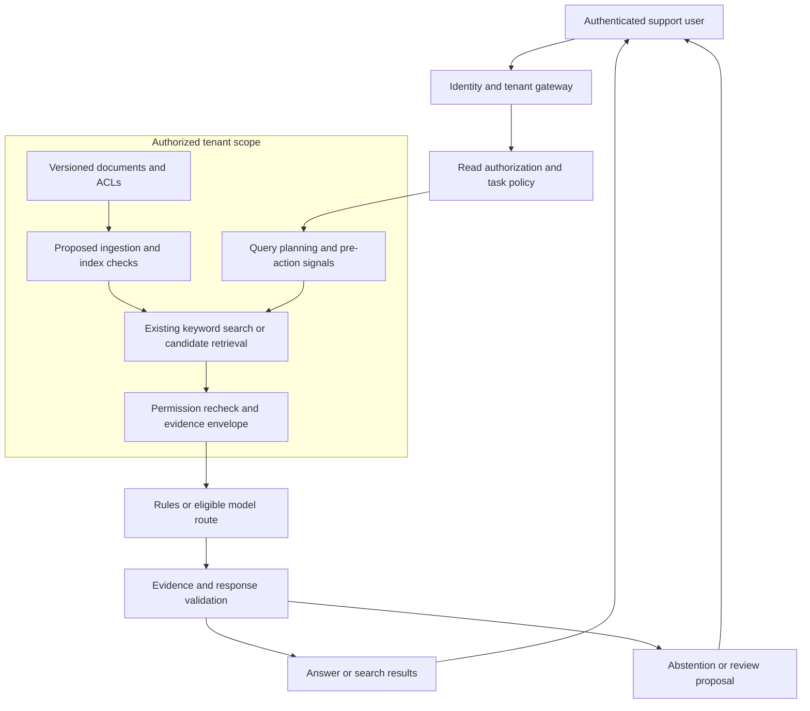

# Tenant-scoped document assistant: architecture and operating-cost evidence report

## Scope and evidence status

✅ This continues the approved evaluation phase. Intake and phase approval are complete. The product is a support assistant, existing keyword search is available, only the supplied toy records are in scope, and incremental spending is prohibited. The product owner owns deployment. This report makes no deployment decision.

✅ No model calls, retrieval queries, integrations, infrastructure changes, external research, or deployment were executed for this report. The architecture and experiment below are specifications. Their execution, quality, permission controls, monitoring, and recovery remain **NOT_RUN**.

| ID | Evidence | State | Limit |
| --- | --- | --- | --- |
| E1 | Existing keyword search is available | SUPPLIED | No baseline outputs or performance measurements supplied |
| E2 | Model A: USD 2 total, retries and human review included; 2 verified successes among 4 tasks | SUPPLIED | Individual task outcomes, retry counts, and cost breakdown absent |
| E3 | Model B: USD 1.20 total, retries and human review included; 3 verified successes among 4 tasks | SUPPLIED | Individual task outcomes, retry counts, and cost breakdown absent |
| E4 | A latency: 100, 200, 300, 1000 ms; B latency: 150, 250, 350, 450 ms | SUPPLIED | Measurement boundary and association with outcomes absent |
| E5 | Architecture, permission controls, routing, fallback, and recovery described below | PROPOSED / NOT_RUN | No implementation or test evidence |
| E6 | Published API prices, provider identities, model versions, volume, corpus content, and production constraints | UNKNOWN | No price lookup, invented prices, or live provider assumptions |

✅ “Verified success” in the arithmetic means the supplied ledger label. No rubric, underlying documents, answers, or verification records were supplied, so this report cannot independently validate those labels. The two four-task samples are not assumed to be paired, representative, or independent production samples.

## Job, boundaries, and success contract

🟡 Proposed job: help an authenticated support user locate and understand documents they are permitted to read within one active tenant, returning supported statements with inspectable source references. Document mutation, account changes, external messaging, purchases, and autonomous actions are outside this job.

🟡 Proposed observable success for a future trial: a task reaches its expected terminal outcome, the answer is correct under the frozen rubric, every material document claim has an authorized supporting source, no forbidden information is exposed, and any required abstention or handoff is correct. An expected abstention can count as success only when the rubric defines it in advance. A handoff counts as successful resolution only if its required human outcome is observed. Otherwise it is a correctly routed but unresolved task.

| Contract | Proposed fields or behavior |
| --- | --- |
| Accepted request | `request_id`, authenticated principal reference, server-established active `tenant_id`, query, permitted read-only task type, optional document filters and locale |
| Identity and tenant | Trusted session establishes identity and tenant membership; a user-supplied tenant string or document text grants no authority |
| Evidence envelope | Document ID, tenant ID, access policy/version, source version, updated time, retrieval time, passage ID, bounded passage text, and source precedence |
| Response | `request_id`, status, answer or search results, source references, evidence gaps, source freshness, and optional review reason |
| Terminal statuses | `answered`, `search_results`, `abstained`, `review_required`, `failed`; include a reason code without leaking inaccessible resource existence |
| Supported tasks | Locate documents, extract supported facts, summarize authorized passages, compare authorized evidence with explicit citations |
| Unsupported tasks | Cross-tenant discovery, unavailable evidence, unauthorized data, state-changing actions, and unsupported claims about current external systems |
| Uncertainty | State which claim lacks evidence; abstain when support is insufficient; do not present model confidence as evidence |
| Stale or conflicting evidence | Apply an owner-defined source hierarchy and freshness rule; if those are absent or conflict remains unresolved, expose the limitation or abstain |
| Human review | Present a proposed handoff containing only authorized evidence; actual messaging or ticket creation requires separate applicable authorization |

🔴 Required workflow volume, response-time target, freshness window, retention policy, source hierarchy, quality threshold, and accepted unresolved-task rate are UNKNOWN. The design can be reviewed, but these missing values prevent a production acceptance conclusion.

## Mechanism comparison

| Mechanism | Hypothesis and proposed fit | Evidence or failure to probe | Operational effort, cost, and reversibility |
| --- | --- | --- | --- |
| Existing keyword search | Users may complete the job directly from ranked authorized sources | Task resolution, relevance, effort, no-result cases, and access enforcement | Available baseline; measure maintenance and human effort; no new model dependency |
| Rules plus keyword search | Deterministic query normalization, filters, or supported answer templates may cover common cases | Rule coverage, ambiguous queries, brittle exceptions, and stale templates | Rule maintenance must be counted; easy to disable individual rules |
| Prompted A or B with fixed authorized context | Generation may improve understanding when evidence is already supplied | Unsupported answers, citation fidelity, structured output, sensitivity to wording, and abstention | Current ledger is the only cost evidence; prompts and models can be versioned and reverted |
| RAG with A or B | Retrieving authorized passages may improve evidence coverage and answers | Corpus readiness, retrieval misses, wrong-tenant retrieval, stale evidence, and unsupported synthesis | Adds ingestion, indexing, retrieval, access synchronization, and monitoring; generation can be disabled while retaining search |
| Model routing | Pre-action signals may allocate an eligible model while preserving task outcomes and budgets | Held-out outcome and cost by slice, route errors, correlated model failures, and fallback overhead | Adds policy and evaluation burden; restore a previous route policy or use search |
| Fine-tuning | Stable, repeated behavior may need learned adaptation | Representative licensed labels and held-out benefit over simpler alternatives | Labels, training, serving, and refresh costs UNKNOWN; no training authorized; not a mechanism for fresh evidence |
| Tool-using agent | Bounded multi-step actions might add value in a broader job | Necessary action sequence, tool authority, actual final state, loop budget, and recovery | Current read-only support job supplies no evidence requiring an agent; no agent execution or delegated worker authority is proposed |

🟡 These are hypotheses, not a ranking. RAG does not establish correctness by itself. The available ledger cannot establish which model belongs on any particular query slice, and it provides no evidence for fine-tuning or an agent loop.

## Proposed data and control flow

🟡 The following is a logical design, not an installed system. All stores, caches, search adapters, and model adapters remain hypothetical in this phase.

🟡 Access checks execute outside model instructions. Retrieval is scoped by the authenticated tenant and document permissions before candidate selection, followed by an authoritative permission recheck before evidence enters a prompt or response. Revoked or unverifiable access fails closed. The generator receives only the minimum authorized passages. A provider’s eligibility to receive those passages, retention behavior, and any data residency requirements are UNKNOWN until evidenced.

🟡 Retrieved text is untrusted data. Instructions embedded in documents cannot modify tenant scope, grant tool access, select credentials, change policies, or bypass validation. Post-generation validation checks response schema, cited source identity and version, current access, and whether the cited evidence supports each material claim. Citation existence alone is insufficient evidence of support.

### Corpus readiness and evidence lineage

🟡 A future corpus audit would record ownership and permitted uses, tenant and ACL completeness, schema validity, source authority, timestamps, duplicates, deleted or revoked records, document conflicts, missing fields, and representative query slices. No document corpus is supplied here, so each audit result is UNKNOWN. No ingestion is authorized by this report.

| Data/control area | Proposed rule | Failure outcome |
| --- | --- | --- |
| Tenant or ACL metadata | Required before indexing and retrieval; never inferred by a model | Quarantine candidate record; fail closed for access |
| Source precedence | Owner-defined authority plus version/freshness policy | Unresolved conflicts cause a qualified response or abstention |
| Duplicate documents | Track canonical source and versions without merging permissions | Preserve ACL boundaries; do not treat duplicates as independent corroboration |
| Missing or unavailable source | Mark coverage incomplete and retain the evidence gap | Search results with a limitation, abstention, or review proposal |
| Evidence lineage | Request and passage IDs link authorized source versions, retrieval, prompt/model version, validation, and final response | Missing lineage prevents a verified supported answer |
| Caching | Key includes tenant, effective permissions/policy version, query, source/index versions, prompt/model version, and route policy | Invalidate on access revocation or source/policy changes; no cross-tenant reuse |
| Storage and retention | Minimize raw query and passage logging; retention and access require owner-defined policy | No new content persistence or cross-session model memory in this phase |

### Routing, fallback, and recovery contract

🟡 A proposed router may use signals available before generation: supported task type, authentication and access status, query size, ambiguity, retrieval coverage, source freshness/conflict, model eligibility, and remaining cost/latency budget. Retrieval scores require calibration; they are not correctness probabilities. Ground-truth task outcomes and later human judgments cannot be router inputs for the same task.

🟡 Route order for an experiment: establish authorization, attempt a supported deterministic response or search path, then use an eligible generator only when evidence and experiment policy permit it. The trial must compare A and B under the same eligible conditions before assigning a model to a production slice. No evidence currently supports assuming A is a higher-quality fallback for B.

| Trigger | Permission boundary | Proposed fallback or recovery | Required evidence |
| --- | --- | --- | --- |
| Invalid identity or tenant membership | No search or generation | Reject with a non-disclosing reason | Gateway decision and no downstream dispatch |
| Search returns a forbidden document or ACL lookup fails | No passage disclosure or model dispatch | Drop the evidence, fail closed, record an incident | Access-denial trace and absence of leaked content |
| No or insufficient authorized evidence | Same tenant and effective permissions | Existing search results with limitations, abstention, or review proposal | Retrieval coverage and terminal status |
| Stale or conflicting sources | No authority expansion | Apply explicit precedence if available; otherwise qualify or abstain | Source versions and conflict reason |
| Untrusted document instructions | Documents supply evidence only | Ignore instructions; validate output; use search/abstention on validation failure | Injection-test outcome and validated response |
| Model unavailable, timeout, or invalid structured output | Only preapproved models with the same data boundary are eligible | Proposed cap: one transient retry per request, no recursive retries; then search/abstention | Attempt count, error class, deadline and outcome |
| Quality validation fails | No unsupported answer release | Search/abstention or proposed review; a second model is a separately measured experimental arm | Validation failure and final outcome |
| Budget or deadline exhausted | No new paid attempt or extra authority | Stop dispatch; return allowed search results or abstain | Budget/deadline state, attempted work, final status |
| Permission revoked during processing | Recheck access before release | Cancel or discard affected output; invalidate related cache | Recheck decision and cancellation/invalidation record |
| Partial retrieval success | Use only authorized verified evidence | Answer only the supported portion with explicit gaps, or abstain under the rubric | Missing-source indicators and claim coverage |
| Retry, duplicate request, or future ingestion replay | Stable tenant-scoped request identity; no business mutations | Correlate attempts; bounded deduplication; index writes would require versioned idempotency keys | Attempt lineage; no duplicate finalization |
| Bad corpus/index or release | No silent switch to broader data | Proposed rollback to a validated snapshot; tombstone revoked data and invalidate caches | Snapshot provenance, access validity, rollback verification |
| Incident or kill switch | Product-owner-controlled routing state | Disable generation and candidate retrieval as needed; allow existing search only if its permissions remain verified | Switch state and proof that new dispatch stopped |

🟡 Proposed generation envelope: at most two calls in total for an enabled experimental request, including any retry or cross-model fallback. An alternate-model fallback must consume that same shared call and time budget and requires its own matched evaluation cell. Numerical deadlines and cost caps beyond the present zero-spend cap are UNKNOWN. In this phase the dispatch limit is zero.

🟡 Compensation is limited to discarding outputs, invalidating caches, canceling pending work, or restoring an authorized index snapshot. There is no business action to undo. Proposed review handoffs, incident creation, rollback, and kill-switch actions are NOT_RUN. Future agent checkpoints and long-session worker state are unnecessary for this bounded read-only design; adding them would require a separately approved action contract.

## Economics worksheet

✅ All figures below are USD and refer only to the supplied toy ledger. The ledger already includes retries and human review, so neither is added again. Published token prices are UNKNOWN and are not used. Price date, review-rate basis, taxes, infrastructure, ingestion, retrieval, storage, and operational labor inclusion are UNKNOWN. The figures are ledger-based task costs, not demonstrated fully loaded production costs.

✅ For each model, use distinct tasks as the attempted-task denominator, not the number of model calls. Retry counts are unknown. With total nonoverlapping ledger cost \(C\), task count \(N\), and verified successes \(S\):

\[
\text{Cost per attempted task}=C/N,\qquad
\text{Verified success rate}=S/N,\qquad
\text{Cost per verified successful task}=C/S.
\]

✅ If \(S=0\), cost per verified successful task is undefined, not zero. All failed-task and retry costs stay in the numerator.

| Measure | Model A | Model B |
| --- | --- | --- |
| Supplied total ledger cost | USD 2.00 | USD 1.20 |
| Distinct tasks in that model's sample | 4 | 4 |
| Verified successful tasks | 2 | 3 |
| Tasks without verified success | 4 − 2 = 2 | 4 − 3 = 1 |
| Verified success rate | 2 / 4 = 50% | 3 / 4 = 75% |
| Cost per attempted task | USD 2.00 / 4 = **USD 0.50** | USD 1.20 / 4 = **USD 0.30** |
| Cost per verified successful task | USD 2.00 / 2 = **USD 1.00** | USD 1.20 / 3 = **USD 0.40** |

✅ In these samples, B’s cost per verified successful task is USD 0.60 lower: \((1.00-0.40)/1.00=60\%\). B’s cost per attempted task is USD 0.20 lower: \((0.50-0.30)/0.50=40\%\). Its observed success rate is 25 percentage points higher: \(75\%-50\%=25\) points. These are descriptive differences, not causal or production estimates.

🟡 Future accounting would collect one task ledger with disjoint components: all model attempts, marginal retrieval/tool usage, human review, and attributable infrastructure/operations. Each charge is recorded once and linked to the parent task, including unsuccessful tasks and recovery. Report marginal costs separately from allocated fixed costs. Without a breakdown, the supplied totals cannot be decomposed or used to estimate ingestion, cache, router, or fallback savings.

🔴 A routing or RAG cost estimate is UNKNOWN. Model-call mix, fallback probability, review frequency, retrieval cost, and volume are absent. Reusing USD 0.40 as a production forecast or treating existing search as free would require unsupported assumptions. The two model samples also cannot be pooled into eight distinct underlying user tasks because task overlap is unknown.

## Latency worksheet

✅ Each model has four observations. Mean is the arithmetic mean. Median is the average of the two middle sorted observations. For p95, use nearest rank, \(x_{\lceil0.95n\rceil}\). With \(n=4\), the rank is \(\lceil3.8\rceil=4\), so the reported p95 is the sample maximum. This convention is explicit because interpolation conventions can produce different answers.

| Measure | Model A | Model B |
| --- | --- | --- |
| Sorted measurements | 100, 200, 300, 1000 ms | 150, 250, 350, 450 ms |
| Sum | 100 + 200 + 300 + 1000 = 1600 ms | 150 + 250 + 350 + 450 = 1200 ms |
| Mean | 1600 / 4 = **400 ms** | 1200 / 4 = **300 ms** |
| Median | (200 + 300) / 2 = **250 ms** | (250 + 350) / 2 = **300 ms** |
| p95, nearest rank | Observation 4 = **1000 ms** | Observation 4 = **450 ms** |
| Observed range | 100 to 1000 ms | 150 to 450 ms |

✅ B’s sample mean is \((400-300)/400=25\%\) lower. B’s sample median is \((300-250)/250=20\%\) higher. Its nearest-rank sample p95 is \((1000-450)/1000=55\%\) lower. B therefore does not improve every reported latency measure.

🔴 Four measurements do not establish a stable tail distribution. Whether these times cover generation alone, retrieval, retries, human review, queueing, or full task completion is UNKNOWN. Success-conditioned latency and paired task differences cannot be calculated without the individual mapping. A future trial would measure both end-to-end system response time and time to verified resolution, with human waiting time reported explicitly.

## Proposed experiment, NOT_RUN

🟡 Objective: compare whether rules/search, supplied-context generation, retrieval, routing, and recovery improve verified task completion within owner-defined constraints. This plan authorizes no execution. Current zero-spend work is limited to this supplied-data analysis; a future trial can use authorized recorded outputs or approved zero-cost fixtures, but cannot call paid services or assume a free quota.

### Freeze and compare

🟡 A matched-task design would use the same task IDs, tenant/permission state, corpus snapshot, expected outcomes, rubric, and judge across arms. Freeze prompts, source/index versions, model versions, decoding settings, tool contracts, retry policy, and timing boundary. Randomize presentation order for human comparison and blind the judge to model identity where feasible. Split routing calibration from held-out evaluation. If corpus, prompt, and model change together, disclose confounding or add isolated cells.

| Arm | Fixed comparison | Question answered |
| --- | --- | --- |
| S0: existing keyword search | Same task and authorized corpus | What quality, task effort, cost, and latency does the available baseline achieve? |
| S1: rules plus existing search | S0 with only the frozen rule layer changed | Do deterministic rules improve supported slices, and where do they fail? |
| P-A and P-B: supplied-context generation | Same authorized evidence packet and answer contract | What changes when only model identity changes? |
| R-A and R-B: RAG | Same corpus, retrieval method, prompt, permissions, and task; A versus B isolated | What are retrieval coverage and model-specific supported-answer outcomes? |
| RAG versus fixed-context control | Same generator and matched authorized evidence; document any changed evidence exposure | Which failures originate in retrieval rather than synthesis? |
| RT: locked pre-action router | Held-out matched cases; compare both fixed-model RAG arms | Does routing preserve quality while changing total task cost and latency? |
| F0 versus F1: fallback | Same primary route; F0 uses search/abstention, F1 adds one eligible alternate-model call within the shared cap | Does fallback recover verified successes after accounting for extra attempts, time, and review? |
| RC: fault-injected recovery | Same task and permissions; controlled fixtures for each failure | Do timeout, revocation, partial results, invalid output, and kill-switch paths reach the specified safe state? |

🔴 Only aggregate toy model costs, success counts, and latency arrays are supplied. No arm above has been executed, including S0. No task-level paired comparison, routing fit, retrieval score, confidence interval for a matched treatment effect, or recovery pass rate is available.

### Slices, rubric, and falsification

| Slice | Expected check | Evidence that would falsify the mechanism hypothesis |
| --- | --- | --- |
| Exact lookup and common support query | Correct authorized source, useful result, bounded user effort | Rules/search fail the owner’s quality or effort criterion |
| Paraphrase and ambiguous query | Relevant retrieval or clarification/abstention | Retrieval misses sources or generation guesses a meaning |
| Multi-document question | Supported synthesis and correct attribution | Model combines unsupported or conflicting claims |
| Missing, stale, or conflicting evidence | Honest limitation, precedence application, or abstention | Confident unsupported answer or hidden coverage failure |
| Cross-tenant probe and restricted document | No content, metadata, or existence disclosure | Any unauthorized retrieval, prompt exposure, citation, or response |
| Revocation and cache reuse | Current access controls every evidence release | A cached or in-flight response exposes revoked data |
| Document prompt injection | Evidence-only treatment of document text | Retrieved instructions change authority, route, or output obligations |
| Timeout, duplicate, partial result, invalid output | Bounded calls, stable lineage, correct terminal outcome | Unbounded retry, duplicate finalization, unsupported partial answer, or silent failure |
| Model routing and fallback | Locked pre-action features and observed incremental success | Test-label leakage, degraded held-out quality, or fallback overhead without sufficient outcome benefit |

🟡 Grade final task outcome, factual support, relevance, citation correctness, abstention, user effort, permission compliance, and terminal-state evidence separately. Record unresolved tasks and escalations alongside verified successes. Use a frozen evidence-based rubric and adjudicate disagreements; a model judge’s unverified opinion does not establish success.

🟡 Report each arm and slice with task count, verified successes, failures, unresolved outcomes, permission violations, total nonoverlapping cost, cost per verified success, mean/median/p95 latency with convention, review effort, and recovery outcome. Preserve task pairing for differences. Sample size and confidence methods must match the owner’s precision needs and task dependence; the present four-task summaries cannot establish a production acceptance threshold.

🟡 Proposed hard boundary: any observed tenant/permission violation blocks release of that tested configuration until the failure is resolved and re-evaluated. Other numerical pass gates, including quality, cost, latency, and allowable review load, remain owner-defined and UNKNOWN here. Passing a finite test suite does not prove absence of access defects.

## Observability, ownership, and handoff

🟡 Proposed traces would correlate tenant-scoped task/request ID, authorization policy version, source/index versions, route policy, model/prompt version, attempt and retry spans, retrieval counts, validation outcome, cost component, duration, and final status. Raw secrets and unnecessary document content would be excluded. Trace access must follow tenant and staff permissions. Logging configuration alone would remain NOT_RUN until a captured trace demonstrates the behavior.

| Responsibility | Proposed accountable role | Required observed evidence |
| --- | --- | --- |
| Deployment, budget and acceptance criteria | Product owner | Owner-recorded decision against the evidence report |
| Corpus rights, authority and freshness | Owner-designated data steward, person UNKNOWN | Corpus audit and versioned source policy |
| Access enforcement and provider eligibility | Owner-designated security/engineering owner, person UNKNOWN | Permission tests, data-boundary evidence and revocation checks |
| Rubric and outcome adjudication | Owner-designated evaluator, person UNKNOWN | Frozen rubric, task-level judgments and disagreement handling |
| Drift and incidents | Owner-designated operator, person UNKNOWN | Authorized trace sampling, slice trend review and incident ownership |
| Rollback and kill switch | Owner-designated operator under product-owner authority | Demonstrated dispatch stop, cache invalidation and valid rollback state |

🟡 Proposed drift checks compare retrieval coverage, abstention, supported-answer rate, review load, permission failures, and task cost/latency by slice against an approved reference. Source or permission changes trigger targeted evaluation. No schedule, alert threshold, incident service, or automation was created.

✅ Phase handoff: the arithmetic supports a descriptive statement that B has lower ledger cost per verified success and lower sample mean latency, while A has lower sample median latency. It does not establish production superiority, a route policy, RAG benefit, or deployment readiness. This report leaves all implementation and deployment choices with the product owner.

🔴 Evidence still needed for a later authorized phase: task-level pairing and outcomes, actual authorized corpus fixtures, source/permission policies, all cost inclusions, latency timing boundaries, model/version/provider eligibility, baseline results, and owner-defined acceptance gates. These are recorded unknowns, not a request to repeat the completed intake or approve this report again.

Confidence score 94% for fidelity to the supplied scope and arithmetic. ✅ Calculated ledger facts; 🟡 proposed design and experiment; 🔴 live economics and production behavior unknown. Follow-up evidence questions: what timing boundary and cost inclusions produced the ledger, and what frozen task-level records and acceptance gates will be available for a later authorized trial?
