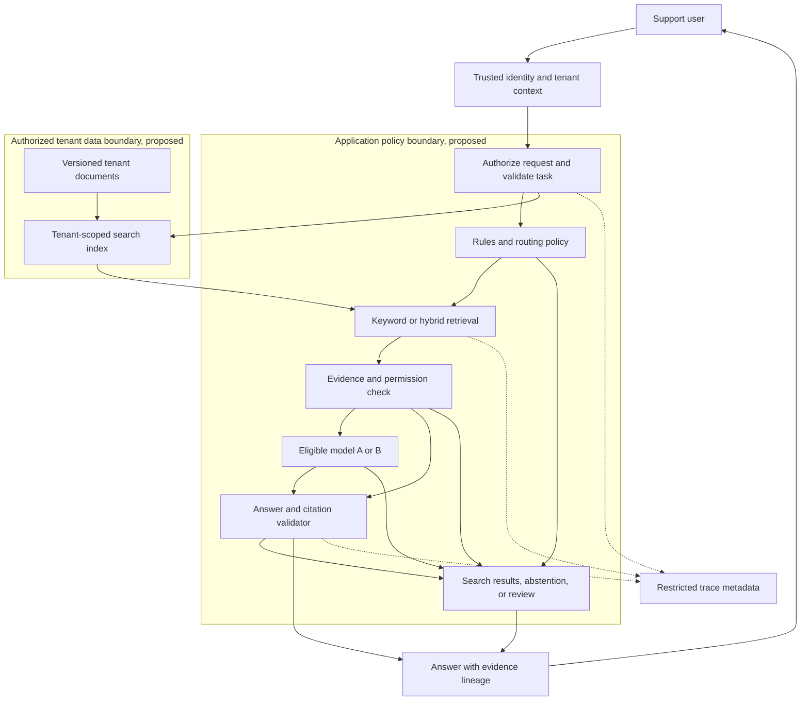

# Tenant-scoped document assistant: architecture and operating-cost evidence report

✅ **Phase and authority.** This continues the approved, already scoped evidence phase. The product is a support assistant. The permitted inputs are the supplied toy records, and the approved deliverable is this report. No integration, external-system access, install, billable call, additional spending, execution of the proposed experiment, or deployment is authorized. The product owner retains the deployment decision. No new intake or approval gate is introduced.

✅ **Evidence boundary.** The numerical evidence is a toy ledger containing four tasks per model and four latency observations per model. It does not include document contents, task-level outcomes, task identities, prompts, model/provider versions, prices, or experimental controls. Existing keyword search is available. All architecture, controls, and experiments below are proposals, with implementation and evaluation status **NOT_RUN**. No external price or provider capability is assumed.

Flags express confidence, separately from evidence state: ✅ 8–10 for supplied facts or reproducible arithmetic; 🟡 5–7 for proposed designs and hypotheses; 🔴 0–4 for claims that the available evidence cannot establish. Tables use explicit evidence-state labels instead of flags.

## 1. Job, boundaries, and evidence register

🟡 **Working job definition.** An authenticated support user asks a bounded question about documents they are entitled to read within one tenant. A successful answer either supplies a supported answer with verifiable source references or correctly abstains when the permitted evidence cannot answer. Cross-tenant disclosure, unsupported factual claims, and pretending an action occurred are critical failures. This definition is proposed for the experiment, rather than a claim that a system already satisfies it.

| ID | Claim or constraint | State | Source or limitation |
| --- | --- | --- | --- |
| E01 | Support assistant; tenant-scoped document job; keyword-search baseline available | GIVEN | Scoped task |
| E02 | Only supplied toy records; no execution, external systems, or spending; product owner owns deployment | GIVEN | Approved phase boundaries |
| E03 | A: USD 2.00 total, including retries and review; 2 verified successes / 4 tasks | GIVEN | Toy task ledger |
| E04 | B: USD 1.20 total, including retries and review; 3 verified successes / 4 tasks | GIVEN | Toy task ledger |
| E05 | A latency: 100, 200, 300, 1,000 ms | GIVEN | Supplied observations; measurement scope unknown |
| E06 | B latency: 150, 250, 350, 450 ms | GIVEN | Supplied observations; measurement scope unknown |
| E07 | Published API price, price date, provider identity, and model versions are not supplied | UNKNOWN values | No price lookup or paid use authorized or needed for this report |
| D01 | Task cost and observed success calculations in section 7 | DERIVED | E03–E04 |
| D02 | Descriptive latency calculations in section 8 | DERIVED | E05–E06 |
| P01 | Proposed architecture, contracts, and controls | PROPOSED / NOT_RUN | Sections 2–5 |
| P02 | Matched-task experiment and fault probes | PROPOSED / NOT_RUN | Section 6 |

✅ Source precedence for this phase is the approved scope and supplied toy records. The numerical ledger supports its stated aggregate accounting, but does not supply evidence of tenant safety, retrieval quality, citation correctness, or production suitability. A missing or failed evidence source remains **UNKNOWN**, rather than being interpreted as a successful check.

🟡 Proposed evaluation slices are exact lookup, bounded extraction, multi-document synthesis, absent evidence, stale/conflicting evidence, ambiguous requests, and unauthorized access. Volume, concurrency, languages, source formats, freshness limits, privacy obligations, latency targets, and owner-defined quality thresholds remain unknown. No additional task or document records have been invented or executed to populate these slices.

## 2. Architecture and control flow

🟡 This is a candidate read-only flow. All components are logical proposals. The existing search capability is a baseline to inspect and test; its tenant isolation and filtering behavior are unverified.

🟡 Identity comes from a trusted application boundary, never from a model-generated or user-asserted tenant identifier. Authorization binds the principal, tenant, allowed document set, and permission revision. Search must constrain candidates to that scope before retrieval, with a second evidence check before any model context is assembled. If the existing index cannot demonstrate those restrictions, its use for this proposed assistant is blocked.

🟡 The rules path can return an authorized exact match or search results with document references. A model path is considered only for a supported task requiring synthesis and only if its privacy, capability, budget, and quality eligibility have been established. Model provider and processing region are unknown, so no live external model is currently eligible. A model receives only the minimum authorized evidence needed for the task. Retrieved text is untrusted data and cannot grant permissions, change routing policy, invoke tools, or override application instructions.

🟡 Every answer carries lineage from request ID to permission revision, corpus snapshot, document/chunk IDs, source versions, retrieval configuration, prompt version, model identifier if used, validation result, and final answer status. Source locators in the response must resolve to the cited authorized version. The post-generation check revalidates access before release. Passing a schema or citation-existence check alone does not prove that a factual claim follows from the source.

## 3. Mechanism comparison

| Mechanism | Hypothesis and required evidence | Quality and risk probes | Cost, latency, and operating effort | Reversibility and current state |
| --- | --- | --- | --- | --- |
| Existing rules and keyword search | Bounded lookups may already solve the job. Measure actual answer finding and user effort. | Missing synonyms, ambiguous matches, stale sources, permission leaks, excessive manual reading | Existing availability is known; marginal cost, maintenance, review effort, and end-to-end latency are unknown | Can remain a standalone baseline or fallback. Availability GIVEN; quality NOT_RUN |
| Prompted model with a bounded, authorized document packet | A prompt may handle extraction or synthesis when all required context is supplied without a retrieval stage. | Unsupported claims, omitted evidence, output schema failures, injection, context limits | All attempts and review count. API prices and context capacity UNKNOWN; ledger economics do not validate this architecture | Revert prompt/version or return to search. Architecture NOT_RUN |
| RAG | Retrieval may improve grounding and reduce context size for a larger authorized corpus. | Retrieval miss, irrelevant chunks, stale index, ACL filtering, citation support, conflicting sources, abstention | Adds ingestion, indexing, retrieval, permission checks, evaluation, and recovery effort. Full cost and latency UNKNOWN | Disable generation and expose scoped search if independently safe. NOT_RUN |
| Model routing | Pre-call signals may identify tasks that rules or a less costly eligible model can handle within quality limits. | Selection bias, routing mistakes, permission-class mismatch, hidden fallback cost, degraded tail latency | Adds router calibration and monitoring. Evaluate the complete routed pipeline, including failures and fallback | Version routing rules and return to a previously evaluated fixed path. NOT_RUN |
| Fine-tuning | Stable behavior patterns might benefit from representative licensed labels after simpler baselines are measured. | Label coverage, held-out gain, memorization, tenant mixing, update burden | Training, evaluation, serving, data preparation, and refresh costs UNKNOWN. No training permitted | No artifact exists; removal would not fix stale evidence. No supporting labels supplied; NOT_RUN |
| Tool-using agent | Bounded actions or multi-step work would need a demonstrated user job and explicit tool authority. | Action authorization, verified final state, loop limits, delegation, compensation, duplicate actions | Additional tool calls, loops, retries, review, and incident recovery create costs and latency | No action tools or autonomous loop in this phase. Outside current execution authority; NOT_RUN |

🔴 The supplied records do not establish that RAG, routing, fine-tuning, or an agent improves this assistant. They also do not establish a production winner between A and B. A lower observed cost per success is a descriptive toy result, not a deployment decision.

## 4. Data and behavior contracts

| Contract | Proposed required fields or behavior | Failure behavior |
| --- | --- | --- |
| Document/input readiness | Owner, tenant ID, document ID, version, ACL and revision, freshness timestamp, content checksum, schema/type, permitted use, and deletion state | Missing ownership, scope, rights, or required version/freshness evidence blocks use; coverage is UNKNOWN |
| Corpus audit | Inventory authorized supplied records; inspect missing fields, duplicates, conflicting versions, parsing coverage, representative slices, and index/source consistency | Do not silently discard failed parses or count missing material as covered |
| Request envelope | Request ID; trusted principal and tenant context; effective permissions; question; allowlisted task type; locale; corpus snapshot; configured deadline | Invalid identity, unsupported task, or unresolved scope yields denial, clarification, or abstention before model dispatch |
| Accepted answer | Status from `answered`, `search_results`, `abstained`, `needs_clarification`, or `review_required`; answer text where appropriate; claim-to-source references; source versions; evidence limitations | Invalid status/schema or unsupported claims block release of the drafted answer |
| Citations | Authorized document and chunk IDs, version and locator, with evidence that each material factual claim is supported | Missing or contradictory support yields a qualified answer with explicit conflict, or abstention |
| Supported scope | Read-only lookup, extraction, and synthesis from the permitted tenant document snapshot | No external knowledge presented as documentary evidence; unsupported tasks are not executed |
| Forbidden actions | No external lookup, account changes, transactions, writes, messages, deployment, or tool execution in this phase | Reject action instructions, including those embedded in documents |
| Stale/conflicting sources | Apply owner-defined source precedence and freshness policy when available; retain provenance | If precedence or freshness cannot be resolved, show the permitted conflict or abstain; do not invent a resolution |
| Unavailable source | Mark retrieval/coverage incomplete and identify the missing evidence category without disclosing inaccessible content | No answer presented as complete; search-only results, abstention, or review |
| Review handoff | Preserve authorized evidence, reason for handoff, draft status, and trace ID for an appropriately authorized reviewer | Do not send anything to a person or external service in this report phase |

🟡 A proposed verified successful task requires an authorized final response, correct task outcome under the frozen rubric, supported citations when an answer is given, and appropriate abstention where the case requires it. Correct abstention is not an answered task, so report answer coverage and task success separately. The historical ledger's original verification rubric is unknown and is not retroactively replaced by this proposed definition.

## 5. Permission, routing, fallback, and recovery matrix

| Event or operation | Enforcement or precondition outside the model | Proposed recovery and observable final state |
| --- | --- | --- |
| Query and retrieval | Trusted identity; current tenant and document permission scope; authorized index partition/filter | Deny on missing scope; record zero unauthorized evidence returned |
| Context assembly | Recheck document ACL, deletion, version, and tenant before dispatch | Omit inaccessible content; if evidence becomes insufficient, abstain |
| Cross-tenant identifier in a request or source | Treat the identifier as untrusted input, never as authorization | Return no inaccessible document, title, snippet, citation, or existence hint |
| Document prompt injection | Content cannot change application policy, access scope, or permitted operations | Ignore embedded instructions; answer only from supported evidence or abstain |
| Model routing | Read-only policy using task type, input size, permission/privacy class, required output schema, and allowed budgets | Route only to an eligible path. Unknown eligibility or cost allowance means no model dispatch |
| Post-search routing | After authorized retrieval, use hit count, calibrated relevance, conflicts, evidence coverage, and source age | Search, abstention, or review if evidence is weak; no success labels or future outcome information used as router inputs |
| No results or conflicting sources | Do not infer facts from the absence of results or fabricate source precedence | Return bounded search results, conflict status, or abstention with coverage limitation |
| Retrieval timeout or temporary failure | Request deadline; read-only operation; current permission scope retained | At most one proposed retry within the original deadline and approved budget; otherwise mark coverage incomplete |
| Model timeout or transient failure | Separate attempt ID under one logical request; no action tools; output released only after validation | At most one proposed retry if allowed by future approved budget. Otherwise use scoped search or abstention; no silent second-model escalation |
| Partial answer or malformed output | Claim support, citation scope, schema, and current authorization checks | Withhold unsafe draft; label partial coverage explicitly only if independently supported, or abstain |
| Permission change during request | Check current authorization again before releasing content | Discard now-inaccessible context and generated content; do not return a stale authorized answer |
| Duplicate request | Request ID plus tenant and permission scope; model attempts separately identified | Read-only retrieval may be repeated, but costs are counted once per actual attempt and answer release is deduplicated |
| Cache hit | Cache key includes tenant, relevant principal/ACL scope and revision, query/task, corpus/source versions, retrieval config, prompt/model/router versions | Reauthorize on read; invalidate on ACL, deletion, corpus, prompt/model, or routing changes; no cross-scope reuse |
| Budget/deadline exhausted | Fixed per-request attempt and elapsed-time limits; no recursive delegation | Stop further work; final status is search-only, abstained, or review required |
| Kill switch or incident | Application-controlled generation disable flag; owner/maintainer roles to be assigned | Disable model path; use only independently verified scoped search, or deny/abstain if isolation is suspect |
| Rollback | Versioned configuration, trace lineage, and known evaluated checkpoint | Restore an eligible prior configuration; verify isolation and task outcomes before treating recovery as complete |

✅ In the current phase, executed retries, live model dispatches, external fallbacks, and spending are all zero. The retry ceiling above is a proposed future experiment parameter, not authorization to perform a retry now.

🟡 Timeout values, total deadlines, quality thresholds, and future per-task cost limits require owner-defined values before any implementation trial. Retries share the original deadline and cannot expand the data scope. Because the assistant is read-only, no business-state compensation is proposed. Recovery from a rejected draft means discarding it, releasing the permitted fallback, and retaining safe trace evidence. Any later action capability would require a separate contract covering idempotency, compensation, and actual final-state verification.

## 6. Matched-task experiment, specification only

✅ **Execution status: NOT_RUN.** The supplied ledger lacks document records, task text, expected answers, permission fixtures, and task-level costs. It supports arithmetic, not a replay or a matched architecture experiment. The following plan describes how evidence could be collected in a separately authorized implementation/evaluation phase; it does not authorize new records, model calls, or systems.

### Cells and isolation

| Cell | Fixed treatment | Primary comparison or falsifier |
| --- | --- | --- |
| C0 | Existing keyword search plus a frozen deterministic rule set; human completion effort measured | Establish actual baseline task outcomes, authorized evidence exposure, user effort, and total task cost |
| C1-A / C1-B | Same answer instruction and approved, bounded document packet; A or B as the only model change | Test prompting without retrieval. Inability to fit the packet or answer safely is a recorded limitation |
| C2-A / C2-B | Same frozen retrieval output and prompt contract; A or B | Compare model behavior with retrieval held fixed |
| C3 | RAG configuration changes with one model, prompt, and corpus held fixed | Test retrieval quality independently; retrieval failure despite relevant authorized evidence falsifies the retrieval hypothesis |
| C4-A / C4-B | Same frozen rule/search-first router; uncertain eligible synthesis tasks routed to fixed A or fixed B | Measure contribution of baseline bypass and routing overhead without changing the model mapping adaptively |
| C5 | A predeclared A/B router using only observable pre-dispatch features, calibrated separately and then frozen | Compare full routed outcomes against C4-A, C4-B, and C0 on held-out matched tasks; failure to preserve quality or reduce total task cost falsifies its benefit |
| C6 | Fixed candidate pipeline with separately injected timeout, empty retrieval, stale source, permission revocation, malformed answer, and unavailable model conditions | Verify safe fallback, bounded retries, cost accounting, deadline enforcement, and observable recovery |

🟡 The plan uses only owner-supplied, authorized toy task/document records if they become available within a separately authorized evaluation. Required fault cases are specifications, not invented evidence. Where a case or capability is missing, record **NOT_RUN / coverage missing**. Do not fill gaps with outside data or claim a fault probe passed because a control is described.

🟡 Freeze task IDs, corpus snapshot, source/permission versions, rules, retrieval settings, prompts, model identifiers, routing code/configuration, output schema, rubric, and judge before comparison. The same task and permitted evidence go through each eligible cell. Record treatment order and repeated-run policy; disclose unavailable seeds or nondeterministic provider behavior. If a corpus or prompt must change, use an additional matched cell or name the confound. Do not attribute a gain to the model when retrieval, evidence, or judge also changed.

🟡 Separate calibration tasks from held-out evaluation tasks before tuning routing thresholds. Include fixed-A and fixed-B policies so an apparent routing gain cannot hide a weak comparator. No task's verified success, post-hoc latency, or final cost is available to the router before that task's dispatch. Aggregate ledger averages are descriptive inputs for planning, not validated predictive routing prices or upper bounds.

### Outcomes, slices, and verification

| Measure | Definition and required evidence |
| --- | --- |
| Verified task success | Independently checked final outcome against frozen task rubric; report numerator and denominator by cell and slice |
| Answer correctness and support | Claim-level source support and completeness; distinguish answering, correct abstention, and wrong abstention |
| Permission safety | Number and severity of unauthorized exposures, including snippets/citations/cache/logs; inspect actual returned data and traces |
| Retrieval quality | Whether required permitted evidence is present in the retrieved set, plus relevance and document-version correctness |
| Coverage and human effort | Answered fraction, abstention/review rates, user search effort, reviewer minutes, and unresolved cases |
| Full task economics | Nonoverlapping costs for every actual task attempt, failed path, retry, retrieval, fallback, and review; denominator is verified successes |
| End-to-end latency | Start at accepted request; end at permitted final response. Record first answer and final verified completion separately when review occurs |
| Recovery | Actual fallback status, retry count, deadline result, evidence scope, and restored configuration; proposed policy is insufficient |

🟡 Critical tenant/privacy failures are reported separately and cannot be averaged away by task success or low cost. A proposed release criterion is no observed critical permission exposure, with exact tested coverage disclosed; passing a small toy suite would still not prove absence of leaks. Business quality floors, acceptable coverage, latency target, review capacity, and acceptable cost remain owner-set unknowns. Therefore this report supplies no deployment pass/fail verdict.

🟡 Predeclare sample size and stopping rules after the owner specifies meaningful effect size, quality tolerance, and representative slices. The current four tasks per model are insufficient to establish general superiority. A future genuinely paired trial can report task-level paired differences and an uncertainty interval appropriate to its design. The present aggregate counts cannot establish paired effects because task identities and pairing are unknown.

## 7. Economics worksheet

✅ **Currency and basis.** All supplied historical amounts are USD. They include retries and human review. Their occurrence date, price date, provider rates, component breakdown, retrieval/tool allocations, and fixed overhead treatment are unknown. No currency conversion is used. These are recorded toy task costs, not a quoted API tariff or a demonstrated fully loaded production cost. The zero-incremental-spending constraint remains separate from this retrospective accounting.

For a ledger with nonoverlapping task costs:

\[
\text{Recorded cost per submitted task} = \frac{\text{total recorded task costs}}{\text{submitted tasks}}
\]

\[
\text{Recorded cost per verified successful task} = \frac{\text{total recorded task costs, including unsuccessful tasks}}{\text{verified successes}}
\]

✅ Zero verified successes makes cost per verified success **undefined**, not zero. Retries are not additional submitted tasks unless the ledger explicitly defines them that way. The supplied four tasks per model are the submitted-task denominator; attempt counts are unknown. Do not add retries or review a second time to the supplied totals.

| Calculation | A | B |
| --- | --- | --- |
| Recorded total, including retries and review | USD 2.00 | USD 1.20 |
| Submitted tasks | 4 | 4 |
| Verified successes | 2 | 3 |
| Observed verified success rate | 2 / 4 = 50% | 3 / 4 = 75% |
| Recorded cost per submitted task | 2.00 / 4 = USD 0.50 | 1.20 / 4 = USD 0.30 |
| Recorded cost per verified success | 2.00 / 2 = USD 1.00 | 1.20 / 3 = USD 0.40 |
| Unsuccessful submitted tasks, still included in total cost | 4 − 2 = 2 | 4 − 3 = 1 |

✅ In this ledger, B has one more verified success, a 25 percentage-point higher observed success rate, and USD 0.80 lower recorded total cost. Relative to A, B's recorded cost per submitted task is `(0.50 − 0.30) / 0.50 = 40%` lower. Its recorded cost per verified success is `(1.00 − 0.40) / 1.00 = 60%` lower. These ratios describe E03–E04 only.

🟡 A future full task-cost ledger would use this component model, counting each component once:

\[
C_i = \sum_{j \in \text{all actual attempts for task } i}
  (C_{\text{model},ij} + C_{\text{retrieval},ij} + C_{\text{tool},ij} + C_{\text{runtime},ij})
  + C_{\text{review},i} + C_{\text{allocated shared},i}.
\]

| Component | Current evidence | Treatment in a future worksheet |
| --- | --- | --- |
| Model input/output and any cached-token charges | Published prices, usage, and price date UNKNOWN | Record actual usage and applicable dated rates or invoice; no invented token price |
| Failed calls and retries | Included in supplied totals; attempt-level amounts UNKNOWN | Count each actual charge, including failed/fallback paths, once |
| Human review | Included in supplied totals; time/rate UNKNOWN | Record minutes and declared loaded rate; distinguish review from other support effort |
| Existing search and retrieval | Availability GIVEN; task-level cost UNKNOWN | Measure incremental queries/runtime and allocate shared infrastructure separately |
| Ingestion/index refresh and storage | UNKNOWN; not performed | Amortize under explicit volume and freshness assumptions, separately from marginal task cost |
| Authorization, validation, observability, incident work | UNKNOWN | Record relevant runtime and labor; distinguish per-task from shared operations |
| Agent/tool execution | Not authorized or performed | No observed execution cost; any future capability needs a new scope and evidence |
| Workflow volume and concurrency | UNKNOWN | Cannot estimate monthly bill, capacity, or scale economics |

✅ The observed aggregate totals cannot be decomposed into provider rates or used to infer a posted token price. Missing components prevent a defensible fully loaded production estimate. The rules/search baseline and every proposed architecture need the same accounting boundary for a valid comparison.

## 8. Latency worksheet

✅ **Convention.** Arithmetic mean is sum divided by four. Median for an even sample is the average of the two central sorted observations. The reported p95 uses the empirical nearest-rank convention, rank `ceil(0.95 × n)`. At `n = 4`, that is rank 4, the observed maximum. These are descriptive measurements, not service-level guarantees.

| Statistic | A | B |
| --- | --- | --- |
| Sorted observations, ms | 100, 200, 300, 1,000 | 150, 250, 350, 450 |
| Sum, ms | 100 + 200 + 300 + 1,000 = 1,600 | 150 + 250 + 350 + 450 = 1,200 |
| Mean, ms | 1,600 / 4 = 400 | 1,200 / 4 = 300 |
| Median, ms | (200 + 300) / 2 = 250 | (250 + 350) / 2 = 300 |
| Empirical nearest-rank p95, ms | Rank 4 = 1,000 | Rank 4 = 450 |
| Observed range, ms | 100 to 1,000 | 150 to 450 |

✅ B's observed mean is 100 ms lower, `(400 − 300) / 400 = 25%` lower relative to A. A's observed median is 50 ms lower. B's observed nearest-rank p95 is 550 ms lower, or 55% relative to A, but with four observations this statistic is simply the comparison of observed maxima.

🔴 The data do not establish the population p95, a stable tail-latency advantage, or an end-to-end reviewed completion time. Other percentile interpolation conventions can produce different values. The sampling window, hardware/provider conditions, task pairing, retry treatment, successful/failed-task mapping, and whether human review or retrieval was included in these latency observations are unknown. No latency per successful task is inferred from unpaired aggregate data.

## 9. Observability and recovery evidence

🟡 Proposed spans are request intake, authorization, retrieval, context assembly, router decision, each model attempt, validation, fallback, and final response. Correlate them under a request/trace ID and separate attempt IDs. Capture configuration versions, safe tenant/scope identifiers, timestamps, status/error classes, evidence IDs, actual usage/cost entries, review duration, and final outcome. Tenant identifiers themselves require controlled access. Default logs exclude document bodies, questions, full answers, credentials, and unrestricted source snippets; restricted review artifacts follow the same authorization and retention boundary as the source.

🟡 Quality sampling would inspect authorized final responses and their actual cited evidence, stratified by task slice, model path, fallback, and failure class. Drift checks would compare retrieval coverage, verified success, abstention, cost, latency, and permission failures against a frozen evaluated configuration. A rollback is evidenced by the active configuration version, permitted output, and repeated relevant recovery/permission checks, not by a switch being present in code.

| Responsibility | Scope and current status |
| --- | --- |
| Product owner | Owns deployment decision and acceptance criteria; ownership GIVEN |
| Data/access owner | Verifies source rights, precedence, freshness, and tenant ACL policy; individual UNKNOWN |
| Evaluation reviewer | Verifies outcomes and critical failure labels under the frozen rubric; individual UNKNOWN |
| Operational maintainer | Owns incident triage, generation disablement, index invalidation, and rollback; individual UNKNOWN |
| This phase | Report and transparent calculations only; no logger, control, integration, fault probe, or evaluation has been implemented or observed |

## 10. Unknowns and phase handoff

| Missing evidence | Consequence for the comparison | Next evidence artifact, within a separately authorized phase |
| --- | --- | --- |
| Task IDs, inputs, expected outcomes, and original success rubric | Cannot verify matched difficulty, pairing, or historical outcome labels | Authorized toy task ledger with task-level rubric and verification evidence |
| Toy document corpus, tenant/ACL fixtures, source versions, rights, and freshness rules | Cannot audit readiness or run tenant/citation tests | Explicitly supplied toy corpus and permission matrix |
| Existing search behavior and cost | No baseline quality, user-effort, isolation, or economic measurement | Baseline traces and verified task outcomes |
| A/B provider and versions, eligibility/privacy terms, usage and dated prices | No live model eligibility or production price estimate | Owner-supplied compatible capability and dated cost records; no paid lookup implied |
| Retrieval, review, failure, retry, and shared-cost breakdown | Aggregate toy ratios cannot become fully loaded production estimates | Nonoverlapping component ledger and declared cost allocation basis |
| Latency measurement scope and task mapping | Cannot connect latency to outcomes or estimate a reliable end-to-end tail | Task/attempt timing traces with explicit start/end boundaries |
| Quality floor, latency target, workload, risk tolerance, and review capacity | No acceptance decision or monthly cost/capacity projection | Owner-defined evaluation criteria and workload assumptions |
| Implementation and operational evidence | Architecture, controls, and experiment remain NOT_RUN | Separately authorized implementation, matched results, and recovery evidence |

✅ **Handoff.** This report supplies the architecture diagram, mechanism comparison, data/behavior contracts, permission/recovery matrix, experiment specification, economics, latency calculations, and evidence gaps. The current evidence establishes the toy arithmetic only. It makes no deployment choice and does not authorize implementation. No reapproval is needed to finish this already approved report; any later execution is outside the current phase.

Confidence score 98% for the supplied-number calculations and scope accounting; architecture effectiveness and production economics remain unverified. Assumptions: four submitted tasks per model, totals already include retries/review, and latency observations are unpaired unless further evidence establishes pairing.

Flag summary: ✅ supplied or derived; 🟡 proposed design; 🔴 unsupported generalization. Follow-up evidence questions to raise confidence: What are the original task-level rubric and paired outcomes, authorized toy corpus and ACLs, latency boundaries, and nonoverlapping cost components? These are handoff evidence gaps, not a repeated intake or a request to execute.
